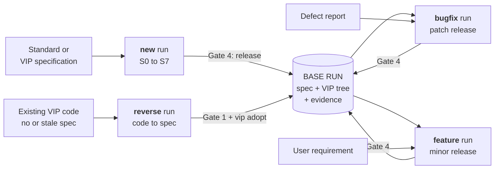
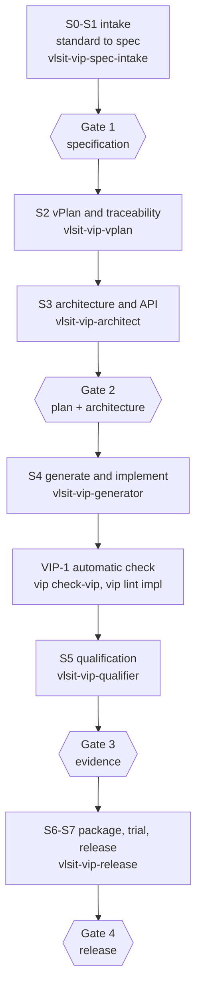
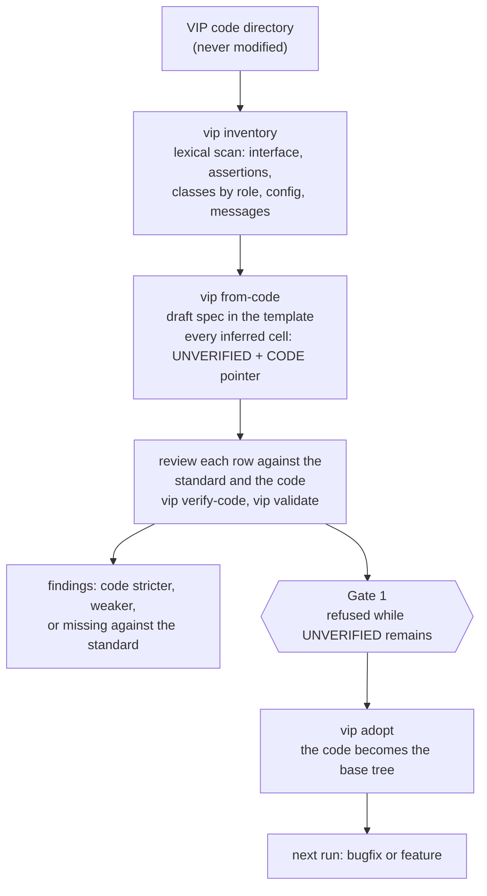
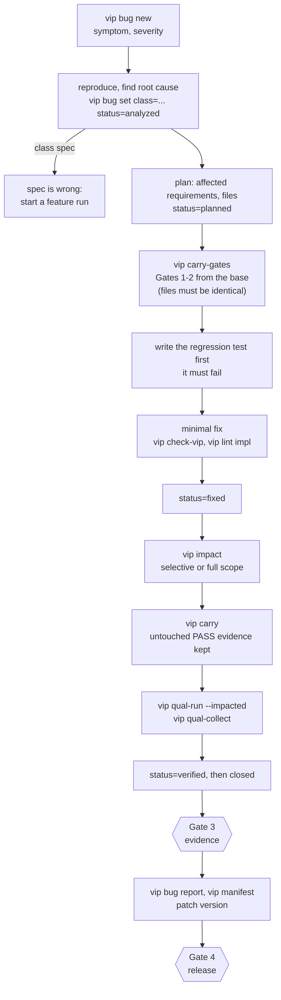
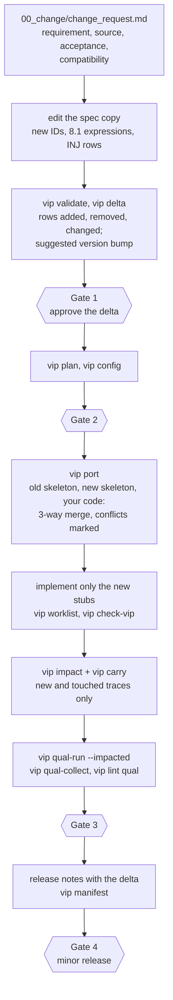

# VLSIT ASIC VIP Design AI Flow / Quy trình AI thiết kế VIP cho ASIC

Skills for Claude Code and Codex CLI that turn a protocol or standard specification into a qualified, documented, easy-to-use SystemVerilog/UVM Verification IP (VIP), and that keep the VIP alive afterwards: analyze existing VIP code into a specification, fix VIP bugs, and add features from a user requirement. Scripts keep the agent's token use low.

Bộ skill cho Claude Code và Codex CLI, biến spec của giao thức hoặc standard thành Verification IP (VIP) SystemVerilog/UVM đã qualify, có tài liệu và dễ dùng; sau đó duy trì VIP: phân tích code VIP có sẵn để sinh spec, sửa lỗi VIP, và thêm tính năng theo yêu cầu của người dùng. Script giúp agent dùng ít token.

## Why this flow / Vì sao có flow này

The flow follows a process built from published protocol-VIP and checker-IP practice (see [docs](docs/VLSIT_VIP_Build_Process.md) and [research evidence](docs/VIP_Research_Evidence.md)):

1. **Protocol specification first.** Every requirement comes from the standard with a clause reference, reviewed by a person other than the implementer. / Mọi requirement lấy từ standard kèm điều khoản, người khác với người cài đặt review.
2. **One input format.** The specification is a markdown file in [VLSIT_ASIC_VIP_Specification_Template.md](spec_template/VLSIT_ASIC_VIP_Specification_Template.md); a validator rejects anything else. / Spec đầu vào là file markdown theo template; validator từ chối mọi thứ khác.
3. **The property is reviewed before it runs.** Each check's expression is written in the specification and reviewed at Gate 1; the generator turns it into the assertion. / Biểu thức của từng check nằm trong spec và được duyệt ở Gate 1; generator sinh assertion từ đó.
4. **Traceability for every requirement.** Requirement, check, coverage, stimulus or injection, positive trace, negative trace, result. / Truy vết từng requirement đến check, coverage, kích thích, trace đúng, trace sai và kết quả.
5. **The VIP is a design under test.** Every check has a legal trace that stays silent and an illegal trace that fires exactly once, against an independent counterpart. / VIP là thiết kế cần kiểm chứng: mỗi check có trace đúng và trace sai với counterpart độc lập.
6. **Evidence, not claims.** A result is `PASS` only with a log; a missing run is `NOT_RUN`. / Kết quả chỉ là `PASS` khi có log; chưa chạy là `NOT_RUN`.
7. **Four sign-off gates** owned by the user. / Bốn gate duyệt do người dùng quyết định.

## Flow / Quy trình

One command, `vip init`, starts a run in one of four modes; every mode uses the same run directory, the same `vip` command, the same gates, and the same evidence rules. / Một lệnh `vip init` mở một run ở một trong bốn chế độ; mọi chế độ dùng chung thư mục run, lệnh `vip`, gate và quy tắc bằng chứng.

### The VIP life cycle / Vòng đời của VIP



```text
 standard / spec ----> [ new run ] ---------------Gate 4--> released VIP --+
                                                                           v
 existing code ------> [ reverse run ]--Gate 1 + adopt--> BASE RUN (spec + tree + evidence)
                                                                           |
                       +---------------------------------------------------+
                       v                                  v
        defect --> [ bugfix run ]            requirement --> [ feature run ]
                   patch x.y.z+1                              minor x.y+1.0
                       |                                       |
                       +----------- Gate 4 -> new base run <---+
```

| You have | Mode | Skill | Command | Result |
|---|---|---|---|---|
| A standard or a VIP specification | `new` | S0 to S7 stage skills | `vip init <root> <tag> <spec.md>` | A qualified, released VIP |
| VIP code, no specification | `reverse` | `vlsit-vip-code-analyzer` | `vip init <root> <tag> --mode reverse --code <dir>` | An as-built specification (Gate 1) and the code adopted as a base |
| A finished VIP and a defect | `bugfix` | `vlsit-vip-bugfix` | `vip init <root> <tag> --mode bugfix --base-run <run>` | A patch release; only touched traces re-run |
| A finished VIP and a new requirement | `feature` | `vlsit-vip-feature` | `vip init <root> <tag> --mode feature --base-run <run>` | A minor release; delta, port, selective re-qualification |

### New VIP (S0 to S7) / VIP mới



| Stage | Skill | Output | Gate |
|---|---|---|---|
| S0, S1 | `vlsit-vip-spec-intake` | validated `<tag>_vip_spec.md`, extraction report | Gate 1: specification |
| S2 | `vlsit-vip-vplan` | `requirements.csv`, `vplan.md`, trace tables | `vip lint plan` |
| S3 | `vlsit-vip-architect` | `vip_config.json`, `vip_arch.md` | Gate 2: plan and architecture |
| S4 | `vlsit-vip-generator` | the `<tag>_vip/` tree, implemented | VIP-1 automatic check |
| S5 | `vlsit-vip-qualifier` | evidence matrix, logs, qualification report | Gate 3: evidence |
| S6, S7 | `vlsit-vip-release` | README, trace report, manifest, release notes | Gate 4: release |
| all | `vlsit-vip-flow` | run directory and state; routes the stages and the modes | enforces all gates |

### Existing VIP code to a specification (reverse) / Từ code VIP có sẵn sang spec



### Fix VIP bugs (bugfix) / Sửa lỗi VIP



### Add features (feature) / Thêm tính năng



What makes a change run cheap and safe / Vì sao run thay đổi nhanh và an toàn:

| Mechanism | Effect |
|---|---|
| Base run is read-only; a change run copies what it needs | The released VIP and its evidence are never altered |
| `vip carry-gates` | Gates 1 and 2 are carried to a bugfix run only when the approved files are byte-identical to the base |
| `vip delta` | The user approves a table-level delta (rows added, removed, changed), not a whole new specification |
| `vip port` | Hand-written code survives a regeneration: three-way merge of the old skeleton, the new skeleton, and the current tree |
| `vip impact` + `vip carry` + `vip qual-run --impacted` | Only traces that the change can affect are re-run; carried entries are labelled `carried:<run>/...`; shared-code changes re-run everything |
| Bug log with gated states | `fixed` needs a named regression test, `verified` needs a log file, `closed` needs the test in the tree |
| `UNVERIFIED` marks and `CODE:` pointers | Everything inferred from code is visible until a person checks it; Gate 1 refuses it |
| Layout `external` | Code that this flow did not generate gets reverse, bugfix, and feature runs with Gates 1, 3, 4 and the project's regression report; generated-layout commands are refused instead of faked |

## Skills / Danh sách skill

Each skill has a Codex copy and a Claude Code copy with the same content. / Mỗi skill có bản Codex và bản Claude Code cùng nội dung.

| Skill | Purpose / Mục đích | Guides / Hướng dẫn |
|---|---|---|
| vlsit-vip-flow | Orchestrate the flow, gates, and run state. / Điều phối flow, gate và trạng thái run. | [Codex](.agents/skills/vlsit-vip-flow/README.md) · [Claude](.claude/skills/vlsit-vip-flow/README.md) |
| vlsit-vip-spec-intake | Standard to validated VIP specification. / Từ standard đến spec VIP đã kiểm hợp lệ. | [Codex](.agents/skills/vlsit-vip-spec-intake/README.md) · [Claude](.claude/skills/vlsit-vip-spec-intake/README.md) |
| vlsit-vip-vplan | Verification plan and traceability. / Kế hoạch kiểm chứng và truy vết. | [Codex](.agents/skills/vlsit-vip-vplan/README.md) · [Claude](.claude/skills/vlsit-vip-vplan/README.md) |
| vlsit-vip-architect | Architecture, API, and `vip_config.json`. / Kiến trúc, API và `vip_config.json`. | [Codex](.agents/skills/vlsit-vip-architect/README.md) · [Claude](.claude/skills/vlsit-vip-architect/README.md) |
| vlsit-vip-generator | Generate and implement the VIP tree. / Sinh và hiện thực cây VIP. | [Codex](.agents/skills/vlsit-vip-generator/README.md) · [Claude](.claude/skills/vlsit-vip-generator/README.md) |
| vlsit-vip-qualifier | Qualification evidence from logs. / Bằng chứng qualification từ log. | [Codex](.agents/skills/vlsit-vip-qualifier/README.md) · [Claude](.claude/skills/vlsit-vip-qualifier/README.md) |
| vlsit-vip-release | Package, trial, release, and spec diff. / Đóng gói, chạy thử, phát hành và diff spec. | [Codex](.agents/skills/vlsit-vip-release/README.md) · [Claude](.claude/skills/vlsit-vip-release/README.md) |
| vlsit-vip-code-analyzer | Existing VIP code to an as-built specification (reverse). / Từ code VIP có sẵn đến spec as-built. | [Codex](.agents/skills/vlsit-vip-code-analyzer/README.md) · [Claude](.claude/skills/vlsit-vip-code-analyzer/README.md) |
| vlsit-vip-bugfix | Bug log, test-first fix, selective re-qualification, patch release. / Nhật ký lỗi, sửa theo test-first, re-qualify có chọn lọc, bản vá. | [Codex](.agents/skills/vlsit-vip-bugfix/README.md) · [Claude](.claude/skills/vlsit-vip-bugfix/README.md) |
| vlsit-vip-feature | Spec delta, port of the implemented VIP, selective re-qualification, minor release. / Delta spec, port VIP đã cài đặt, re-qualify có chọn lọc, bản minor. | [Codex](.agents/skills/vlsit-vip-feature/README.md) · [Claude](.claude/skills/vlsit-vip-feature/README.md) |

## Setup / Cài đặt môi trường

Required: Python 3.11 or later (standard library only). Optional, used when found (`python3 shared/scripts/check_env.py` shows what was found):

| Tool | Used for | Install |
|---|---|---|
| slang | Type-check of the whole UVM tree against the official UVM, UVM-free lint fallback | Part of OSS CAD Suite, or a slang release |
| Verilator | Lint of the interface and checker without UVM, simulation and formal modes | Part of OSS CAD Suite |
| Accellera UVM 2020.3.1 (IEEE 1800.2-2020) | Reference library for the UVM type-check | `python3 shared/scripts/check_env.py --install-uvm <DIR>` clones the pinned tag; set `VLSIT_UVM_HOME` or `vip set uvm_home=<DIR>` |
| A UVM simulator | Running the quickstart and the qualification traces | Your project's simulator; give the commands with `vip set build_cmd=... run_cmd=...` |

UVM 2020.3.1 was chosen because it is the current Accellera release and the IEEE 1800.2-2020 reference; the base library and the generated code use the subset that UVM 1.2 shares.

Check the whole repository at any time: `python3 scripts/selftest.py` (about 30 seconds).

## Skill locations and installation / Vị trí skill và cách cài

| Tool | Project-level folder | Personal folder |
|---|---|---|
| Codex CLI | `.agents/skills/<skill-name>/` | `$HOME/.agents/skills/<skill-name>/` (some installers use `$CODEX_HOME/skills/`) |
| Claude Code | `.claude/skills/<skill-name>/` | `$HOME/.claude/skills/<skill-name>/` |

1. **Use this repository directly.** Open it in Claude Code or Codex CLI; each tool discovers its own folder. Restart Codex if a new skill does not appear. / Mở repository trực tiếp; mỗi công cụ tự nhận diện thư mục của nó.
2. **Copy all ten skills** into the target project (keep each folder whole). The flow skill routes to the others. / Chép đủ mười skill vào project đích, giữ nguyên từng thư mục.
3. **Claude Code, one session from elsewhere:** `claude --add-dir <this repository>`.
4. **Codex from GitHub:** `$skill-installer Install vlsit-vip-flow from <OWNER>/<REPOSITORY>, path .agents/skills/vlsit-vip-flow` (repeat for each skill).

Invoke: Claude Code `/vlsit-vip-flow ...`; Codex CLI `$vlsit-vip-flow ...`. Both can also select a skill from the request text.

    /vlsit-vip-flow Build a VIP from <SPEC_FILE>. Output root: <OUTPUT_ROOT>. Project: <PROJECT>. Author: <NAME>. Simulator: <SIMULATOR>. Stop at each gate for my approval.

The other modes (Codex: replace `/` by `$`):

    /vlsit-vip-code-analyzer Analyze the VIP code in <CODE_DIR> and write its specification. Tag: <TAG>. Standard: <STANDARD, REVISION>. Output root: <OUTPUT_ROOT>.
    /vlsit-vip-bugfix Fix this VIP defect in <BASE_RUN>: <SYMPTOM>. Output root: <OUTPUT_ROOT>. Write the regression test first.
    /vlsit-vip-feature Add this requirement to the VIP of <BASE_RUN>: <REQUIREMENT>. Output root: <OUTPUT_ROOT>. Stop at each gate for my approval.

## The `vip` command / Lệnh `vip`

Every skill bundles `scripts/vip.py`, a run-aware command: it finds the run directory, takes paths and settings from the run state, and prints short output.

    vip init <root> apb <spec.md>          vip plan                vip gen
    vip set author=".." project=".."        vip lint plan           vip worklist --n 5
    vip next                                vip config              vip check-vip
    vip brief S4                            vip query rows requirements ...   vip qual-init / qual-run / qual-collect
    vip rules VCHK VIFC                     vip gate G1 APPROVED --by ".."    vip manifest / lint release

Change runs and existing code:

    vip init <root> axi --mode reverse --code <dir>       vip inventory / vip from-code / vip verify-code / vip adopt
    vip init <root> apb --mode bugfix --base-run <run>    vip bug new|set|list|report    vip carry-gates --by ".."
    vip init <root> apb --mode feature --base-run <run>   vip delta    vip port
    (bugfix and feature)                                  vip impact    vip carry    vip qual-run --impacted

`vip` stands for `python3 scripts/vip.py` in a skill folder; `python3 scripts/vip.py help` lists every command.

## Token efficiency / Tiết kiệm token

| Feature | Effect |
|---|---|
| Short `SKILL.md`; stage brief (`vip brief`); rule text by group (`vip rules <PREFIX>`) | At the start of a stage the agent reads about 50 K characters instead of about 303 K (measured over the six working stages: 84 % less; at 4 characters per token, about 12.5 K tokens instead of 75.8 K) |
| Compact output: findings grouped by code, three examples each, run path shortened to `<run>` | A trace lint prints about 10 lines instead of one line per finding; `--full` restores everything |
| `vip scaffold` | Writes 12 KB of rule-driven specification tables (usability contract, checker policy, qualification plan, gates, packaging, roles) so only the 84 protocol-specific cells are written |
| Check expressions in the specification (Section 8.1) | The 9 APB assertions are generated complete from 9 table rows; the generated tree has no check stub left |
| Generated qualification tests | The generator writes the 23 test classes (23 KB); only one counterpart stimulus task per trace is written |
| `vip query`, `vip worklist`, `vip impl-check` | Read one row, list only the stubs left with their requirement context, complete one SVA stub from an expression |
| `vip check-vip` | Lint and UVM type-check in one command; a few lines out, full output in a log |
| `vip next`, `vip check` | The next action and the exit check, without reasoning over state |

The numbers are measurements of this repository's own files and outputs on the APB example, not of a model's token counts; the 84 % figure compares reading the reference documents in full (the earlier instruction) with the current instruction.

## The mandatory input: a markdown specification / Đầu vào bắt buộc: spec markdown

The input is a VIP specification in [VLSIT_ASIC_VIP_Specification_Template.md](spec_template/VLSIT_ASIC_VIP_Specification_Template.md): YAML front matter, 16 numbered sections, and machine-readable tables with stable IDs (`VREQ-<TAG>-<NNNN>`, `BND`, `CAP`, `INJ`, `DEC`, ...). If you only have the standard, `vlsit-vip-spec-intake` produces the specification (`vip scaffold` first). A filled example is [examples/apb/APB_VIP_Specification.md](examples/apb/APB_VIP_Specification.md).

    python3 shared/scripts/validate_vip_spec.py <SPEC.md>
    python3 shared/scripts/validate_vip_spec.py spec_template/VLSIT_ASIC_VIP_Specification_Template.md --template

## Repository layout / Cấu trúc

| Path | Content |
|---|---|
| `spec_template/` | The input template, the VIP design rules (`V...` rule IDs), and a README |
| `shared/` | Single source of the files that skills bundle: scripts and reference documents |
| `.claude/skills/`, `.agents/skills/` | The ten skills for Claude Code and Codex CLI |
| `scripts/` | `sync_skills.py` (copies shared files into the skills and mirrors Claude to Codex; `--check` reports drift) and `selftest.py` |
| `examples/apb/` | A filled APB specification (worked example) |
| `docs/` | The build process (Appendix B: reverse, bugfix, feature) and the research evidence (Vietnamese) |

Edit shared files in `shared/`, `spec_template/`, or `examples/`; edit skill-specific files in `.claude/skills/<skill>/`; then run `python3 scripts/sync_skills.py`. Do not edit the bundled copies inside a skill or the `.agents` folder by hand.

## Verification status of this repository / Trạng thái kiểm chứng

Measured on 2026-10-10 with Python 3.11, Verilator 5.053, slang 12.0.0, and Accellera UVM 2020.3.1 (commit `78c0654`). `python3 scripts/selftest.py` reproduces these results.

| Item | Result |
|---|---|
| Template and APB example validation, plus deliberately broken variants | PASS; every broken variant rejected |
| Plan, configuration, generation, gates, drift detection, run-aware `vip` command | Run end to end on the APB example (APB4 profile, APB3 profile, and a variant with a `CLASS` check) |
| Interface and checker lint (Verilator `-Wall`), simulation and formal modes | PASS, 0 warnings, with the 9 APB checks generated from the specification |
| UVM type-check of the generated tree against UVM 2020.3.1 with slang: base library, agent, driver, monitor, coverage, sequences, quickstart, 23 qualification test classes | PASS, 0 errors; deliberate API mistakes were caught |
| Runner and collector logic, qualification and release lint, manifest, spec diff | Run against a synthetic simulator and fixtures; they prove the script logic only |
| Reverse run: inventory, draft specification, `verify-code`, Gate 1 refusal while `UNVERIFIED` remains, adoption | Run on the generated APB tree (9 assertions, 13 signals, 9 requirements, 9 expressions drafted) and on an external UVM VIP of 101 files and 132 classes (inventory and draft only) |
| Bugfix run: gated bug states, carried gates, impact (selective, 3 of 24 traces), carried evidence (42 PASS), re-run of the impacted traces only | Run end to end on the APB base run with the synthetic simulator; proves the script logic only |
| Feature run: change request, spec delta, plan, port with a hand-written line kept, impact (selective, 2 of 25 traces), carried evidence (46 PASS), re-run of the 4 new entries | Same; the ported tree passes `check-vip` (Verilator lint, slang UVM type-check); a deliberate overlapping edit produced conflict markers and HY-09 |
| External layout: generated-layout commands refused, Gate 2 not applicable | Run (bugfix run on adopted code) |

What was **not** run and is `NOT_RUN`:

- **Simulation** of the UVM code (quickstart, qualification traces): no UVM simulator was available. The type-check shows the code compiles against the official UVM; it does not show run-time behavior.
- **Run-time behavior of the SVA checks.** Lint shows they parse; the qualification traces are what show they are right.
- **Clause numbers** of the APB example (DEC-001); formal use of the checkers.

## Known limitations / Hạn chế

- The code scan is lexical: it can miss constructs produced by macros or generate blocks, and it does not resolve inheritance across files it did not scan. A spec drafted from code is a draft: every inferred cell stays `UNVERIFIED` until a person checks it against the standard.
- `vip port` needs `spec/vip_generation.json`, which the generator writes; a VIP built before that file existed, or not built by this flow, is changed in place (layout `external`: Gates 1, 3, 4, the project's regression report, `vip impact --files`).
- `vip impact` is conservative: a change outside a check block, a sequence, a stimulus task, or a test is treated as shared and re-runs every trace.
- One build covers one profile; further profiles use `vip gen-profile` and their own evidence file.
- A width change is a recompile with `+define`; one compile supports one parameter set (VIFC-01).
- Monitor, driver, and sequence bodies are written by the agent from the worklist; they are not generated.
- Vendor command templates in the qualification guide are illustrative and unverified.

## License / Giấy phép

Apache License 2.0, see [LICENSE](LICENSE) and [NOTICE](NOTICE). Files that carry code have an `SPDX-License-Identifier: Apache-2.0` line. The Accellera UVM library is not distributed here; it is Apache-2.0 licensed and installed by the user. A VIP generated for your project carries the license that your project chooses (PK-05).

## Language convention / Quy định ngôn ngữ

Skill instructions, technical references, code comments, plans, reports, and script outputs use precise scientific and engineering English. Only README files and explicitly designated user guidelines (including the documents in `docs/`) are bilingual or Vietnamese.

Nội dung skill, tài liệu kỹ thuật, comment code, kế hoạch, báo cáo và đầu ra script dùng tiếng Anh khoa học và kỹ thuật chuẩn. Chỉ README và tài liệu guideline cho người dùng (gồm `docs/`) dùng song ngữ hoặc tiếng Việt.

## Official documentation / Tài liệu chính thức

- [Codex skills](https://developers.openai.com/codex/skills)
- [Claude Code skills](https://code.claude.com/docs/en/skills)
- [Claude Code plugins](https://code.claude.com/docs/en/plugins/overview)
- [Accellera UVM reference implementation](https://github.com/accellera-official/uvm-core)
